<div align="center">

# Remi

### Trợ lý AI chăm sóc khách hàng + CRM cho doanh nghiệp dịch vụ trên Zalo

Khách nhắn lúc 2 giờ sáng vẫn được trả lời đúng giá, đúng chính sách. Khách cũ được nhắc lịch, hỏi thăm, mời quay lại.
Chủ doanh nghiệp xem tất cả trên một màn hình.

[](https://dotnet.microsoft.com/)
[](https://github.com/pgvector/pgvector)
[](https://redis.io/)
[](https://www.hangfire.io/)
[](https://nextjs.org/)
[](#-bộ-não-ai)
[](#-chất-lượng)
[](#-cô-lập-dữ-liệu-giữa-các-doanh-nghiệp)

[Tính năng](#-tính-năng) · [Kiến trúc](#-kiến-trúc) · [Bộ não AI](#-bộ-não-ai) · [Bảo mật](#-bảo-mật-và-tuân-thủ) · [Chạy local](#-chạy-local) · [Tài liệu](#-tài-liệu)

</div>

---

## ✨ Remi là gì

Remi là nền tảng SaaS **thuê theo tháng**, nhiều doanh nghiệp dùng chung một hệ thống nhưng dữ liệu tách biệt tuyệt đối. Mỗi doanh
nghiệp (spa, nha khoa, sửa chữa nhà, bán lẻ, giáo dục...) có:

- **Trợ lý AI trên Zalo** trả lời khách 24/7, **chỉ dựa trên dữ liệu doanh nghiệp nạp vào** (bảng giá, FAQ, quy trình). Không chắc
  thì nói thật và chuyển nhân viên, không bịa giá.
- **Chăm sóc chủ động**: chào khách mới, nhắc lịch, hỏi thăm sau buổi, báo gói sắp hết, mời khách cũ quay lại.
- **CRM đầy đủ cho doanh nghiệp dịch vụ**: lịch hẹn, thu ngân, gói liệu trình, kho, nhân viên, báo cáo, nhiều chi nhánh.
- **Trang quản trị web** để nạp dữ liệu, xem hội thoại realtime, tiếp quản chat, xem khách tiềm năng và số liệu.

> **Nguyên tắc vàng:** AI chỉ *đề xuất*, hệ thống mới *chốt*. Lịch hẹn, tiền, giảm giá luôn đi qua kiểm tra của hệ thống.

---

## 🧭 Tính năng

<table>
<tr>
<td width="33%" valign="top">

**🤖 Trợ lý AI**
- Trả lời theo kho kiến thức riêng (RAG)
- Giọng văn, xưng hô theo từng doanh nghiệp
- Tự chuyển nhân viên khi cần
- Gợi ý gói, thu thập thông tin khách
- Bộ an toàn cho ngành sức khỏe

</td>
<td width="33%" valign="top">

**💬 Hộp thư & tiếp quản**
- Realtime bằng Server-Sent Events
- "Tiếp quản" / "Trả lại cho bot"
- Nhắc khi khách chờ quá lâu
- Báo nhân viên qua Telegram
- Tin nhắn mẫu, nhật ký chăm sóc

</td>
<td width="33%" valign="top">

**📅 Lịch hẹn**
- Lịch theo nhân viên, giường, phòng
- Bot đặt, đổi, hủy lịch qua chat
- Nhắc lịch 2 mốc, check-in
- Lịch định kỳ, hàng chờ
- Tóm tắt khách trước buổi hẹn

</td>
</tr>
<tr>
<td valign="top">

**💳 Bán hàng & gói**
- Hóa đơn, giảm giá có duyệt
- Thanh toán, mã VietQR
- Gói trừ buổi, thẻ trả trước
- Voucher, chốt ca thu ngân

</td>
<td valign="top">

**📦 Kho & nhân viên**
- Tồn kho theo chi nhánh
- Nhập, xuất, kiểm kê, chuyển kho
- Định mức vật tư theo dịch vụ
- Ca làm, hoa hồng, chấm công

</td>
<td valign="top">

**📊 Báo cáo**
- Hôm nay, doanh thu đa chiều
- Hiệu quả AI, tỷ lệ bot tự xử lý
- Lấp đầy, giữ chân, công nợ
- Hỏi số liệu bằng tiếng Việt

</td>
</tr>
<tr>
<td valign="top">

**📣 Chăm sóc chủ động**
- AI gợi ý ai cần nhắn, vì sao
- Tin nháp, nhân viên duyệt
- Khung giờ và tần suất cài cứng
- Nhắn "hủy" là dừng

</td>
<td valign="top">

**🔌 Đa kênh**
- Zalo Official Account (API chính thức)
- Nick Zalo cá nhân của doanh nghiệp (đăng nhập QR)
- Khung chat thử trên trang quản trị
- Thêm kênh mới không sửa worker

</td>
<td valign="top">

**🏢 SaaS đa doanh nghiệp**
- Mẫu ngành: prompt, câu cấm, flow
- Nhiều chi nhánh, phân quyền chi tiết
- Hạn mức hội thoại theo gói
- Super admin: gói, hạn, chi phí AI

</td>
</tr>
</table>

---

## 🏗 Kiến trúc

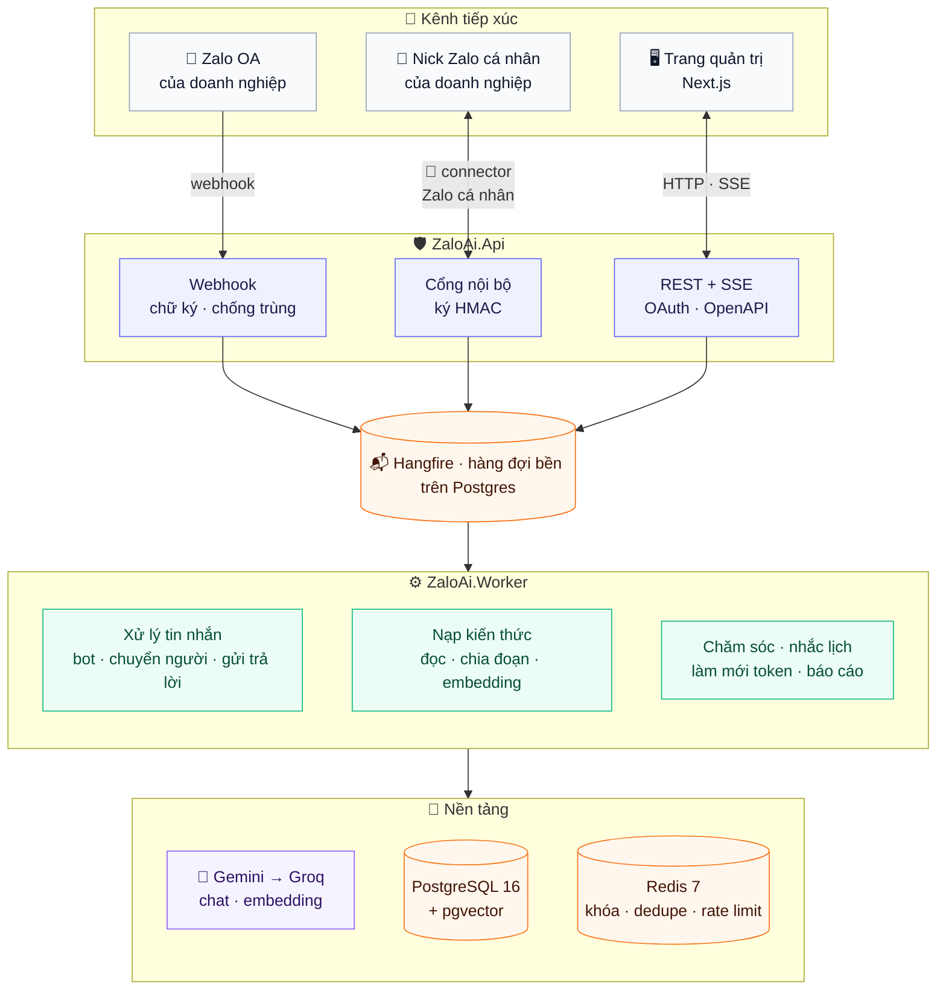

| Thành phần | Vai trò |
| --- | --- |
| **API** | Nhận webhook (xác thực chữ ký → chống trùng → đẩy vào hàng đợi → trả 200 ngay), OAuth kết nối OA, REST + SSE cho trang quản trị. **Không bao giờ gọi AI trong request webhook.** |
| **Hangfire** | Hàng đợi lưu trong Postgres: không mất tin khi khởi động lại, retry có backoff, job hỏng hết lượt thì cảnh báo. |
| **Worker** | Chạy bot, nạp kiến thức, làm mới token, chăm sóc chủ động, nhắc lịch, báo cáo. Chạy được nhiều bản song song. |
| **Redis** | Khóa phân tán (làm mới token, gửi tin chăm sóc), `state` OAuth có hạn, chống trùng webhook, giới hạn tốc độ gửi theo kênh. |
| **Connector Zalo cá nhân** | Tiến trình Node.js riêng, nói chuyện với API qua HTTP nội bộ có chữ ký HMAC, theo hợp đồng `connectors/zalo-personal/CONTRACT.md`. |

### Hành trình một tin nhắn

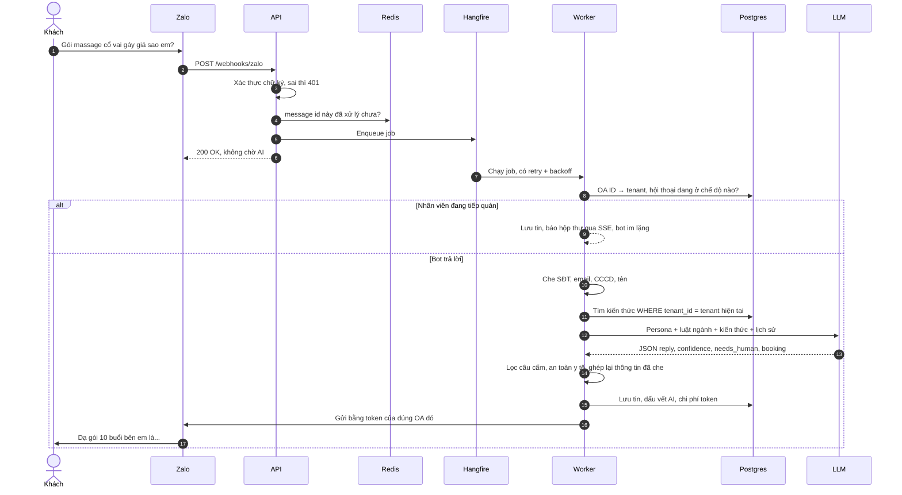

---

## 🧠 Bộ não AI

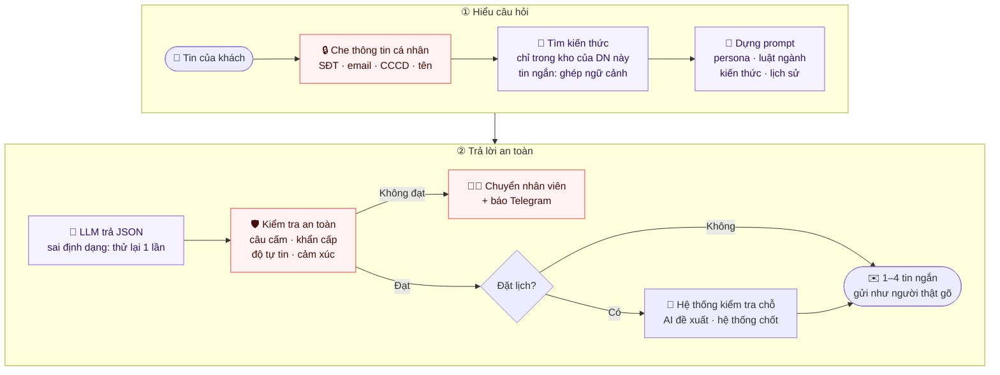

**Câu trả lời có cấu trúc.** AI không trả văn bản tự do mà trả JSON:
`reply` · `used_chunk_ids[]` · `confidence: high|medium|low` · `needs_human` · `handoff_reason` · `lead_fields{}` · `sentiment` · `booking`.
Nhờ vậy mỗi câu trả lời đều biết **dựa vào đoạn kiến thức nào**, lưu lại để trả lời câu hỏi "vì sao bot nói vậy?" ngay trên hộp thư.

**Dự phòng nhà cung cấp AI** (mẫu Chain of Responsibility + Circuit Breaker):

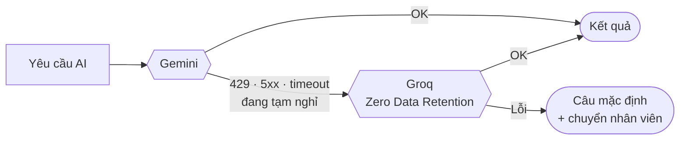

**Đo chất lượng bằng eval.** `src/ZaloAi.Ai/Evals/` chứa bộ câu hỏi mẫu theo ngành (kể cả hội thoại nhiều lượt) + đáp án mong đợi;
chạy lại mỗi khi đổi prompt hoặc model. Câu bot trả lời sai ngoài thực tế được thêm vào eval.

### Kho kiến thức (RAG)

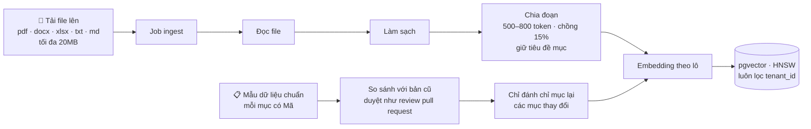

---

## 🔄 Vòng đời hội thoại

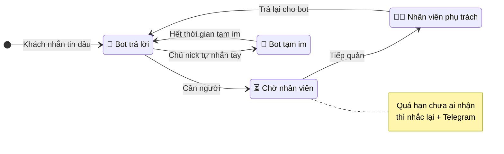

Bot tự chuyển sang **"Cần người"** khi: AI báo `needs_human`, khách đòi gặp người, cảm xúc tiêu cực, độ tự tin thấp, dấu hiệu khẩn
cấp (ngành sức khỏe), hết hạn mức hội thoại của gói, hoặc kênh tạm không gửi được. Câu chuyển tiếp có bản trong giờ / ngoài giờ,
doanh nghiệp tự sửa. Khi nhân viên đang phụ trách, **bot không chen vào**.

---

## 📣 Chăm sóc chủ động

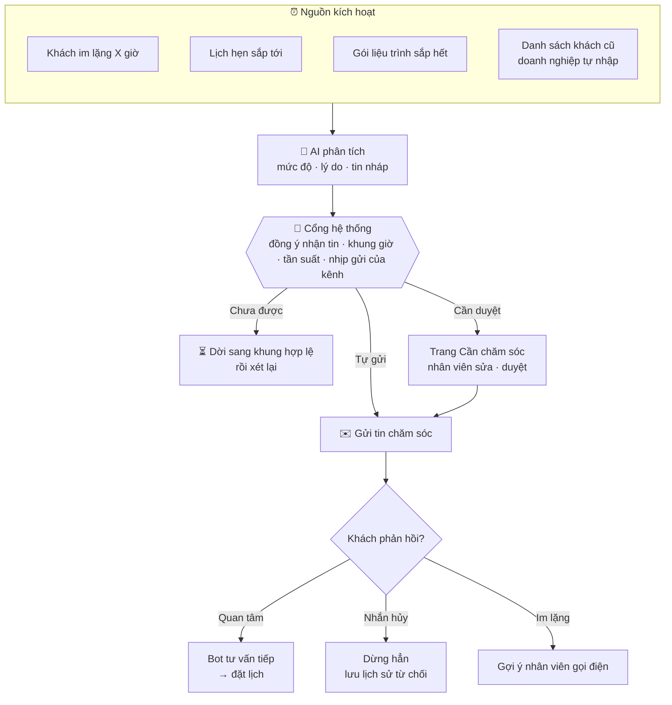

Mọi giới hạn (khung giờ gửi, tần suất tối đa, số tin mỗi ngày của từng kênh) **cài cứng ở tầng hệ thống**: AI không vượt qua được.
Kênh nhắn cá nhân có thêm nhịp gửi an toàn, tự giảm tốc khi tỷ lệ phản hồi xấu, và chỉ liên hệ người **đã có quan hệ với doanh
nghiệp** (doanh nghiệp xác nhận nguồn khi nhập).

---

## 🔐 Cô lập dữ liệu giữa các doanh nghiệp

Lộ dữ liệu của doanh nghiệp A sang doanh nghiệp B là lỗi nghiêm trọng nhất có thể xảy ra, nên có **nhiều lớp chặn độc lập**:

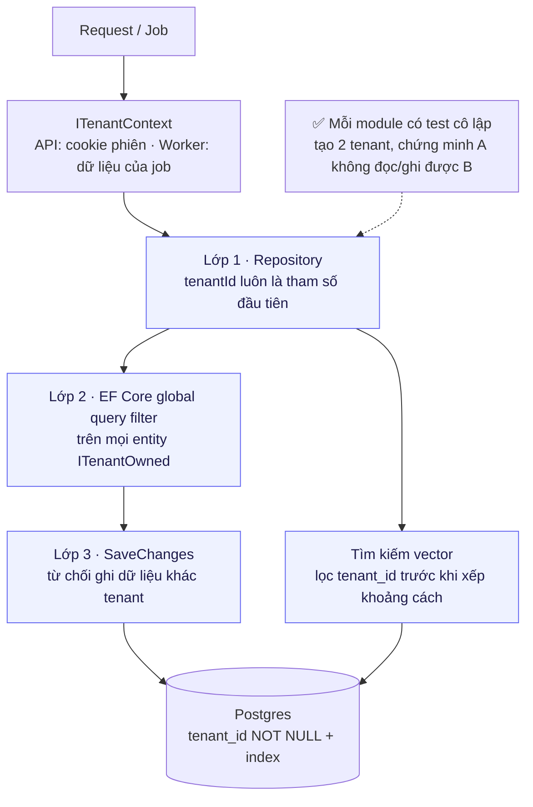

---

## 🧱 Cấu trúc mã nguồn

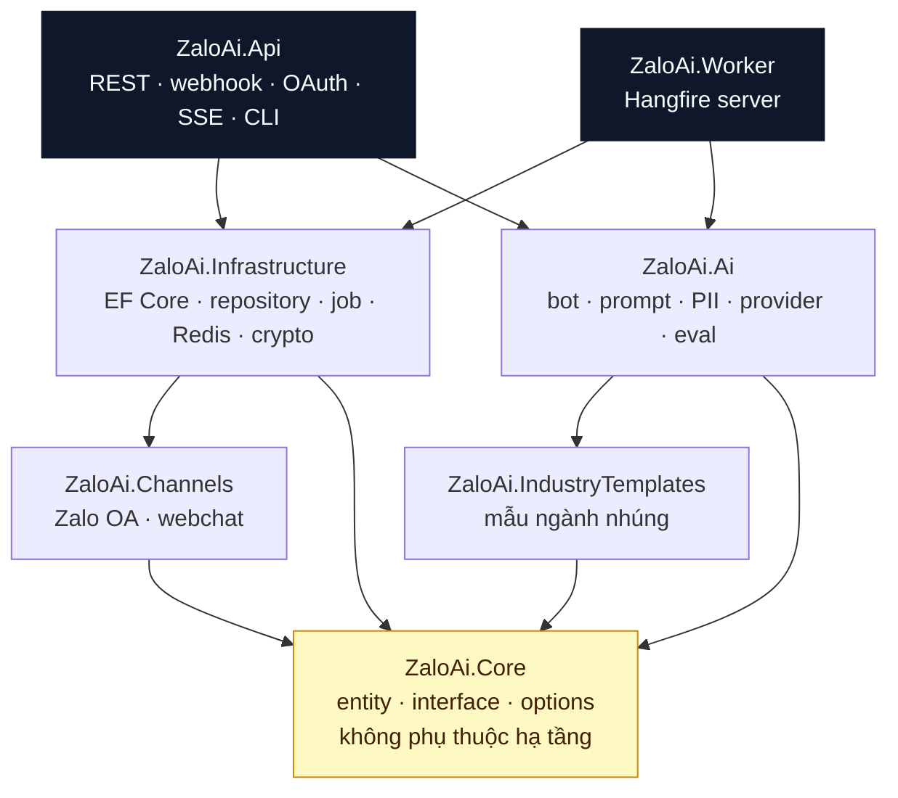

```
zalo-ai-assistant/
├── src/
│   ├── ZaloAi.Api/                # Minimal API: auth cookie, webhook, OAuth, admin REST, SSE, OpenAPI
│   ├── ZaloAi.Worker/             # Hangfire server: tin nhắn, ingest, token, chăm sóc, báo cáo
│   ├── ZaloAi.Core/               # Entity, interface, options, lỗi chung (không phụ thuộc hạ tầng)
│   ├── ZaloAi.Infrastructure/     # DbContext + migrations, repository có tenant, job, Redis, mã hóa
│   ├── ZaloAi.Ai/                 # BotEngine, PromptBuilder, PII masking, Gemini/Groq, evals
│   ├── ZaloAi.Channels/           # IChannelAdapter: Zalo OA, webchat
│   └── ZaloAi.IndustryTemplates/  # Mẫu ngành: prompt, câu cấm, câu hỏi thu thập, flow
├── connectors/zalo-personal/      # Connector kênh Zalo cá nhân (Node.js, TypeScript)
├── tests/
│   ├── ZaloAi.UnitTests/
│   └── ZaloAi.IntegrationTests/   # Testcontainers: Postgres + Redis thật
├── docs/                          # Kế hoạch, quyết định, đặc tả, kịch bản test
├── scripts/                       # backup/restore DB, seed demo, tunnel
└── docker-compose.yml             # pgvector/pgvector:pg16 + redis:7
```

Trang quản trị nằm ở repo riêng `zalo-ai-portal` (Next.js App Router, TypeScript strict, Tailwind, shadcn/ui), gọi API qua client
sinh tự động từ OpenAPI (`pnpm gen:api`), không chứa secret, không kết nối DB.

### Kênh nhắn tin: một interface, nhiều adapter

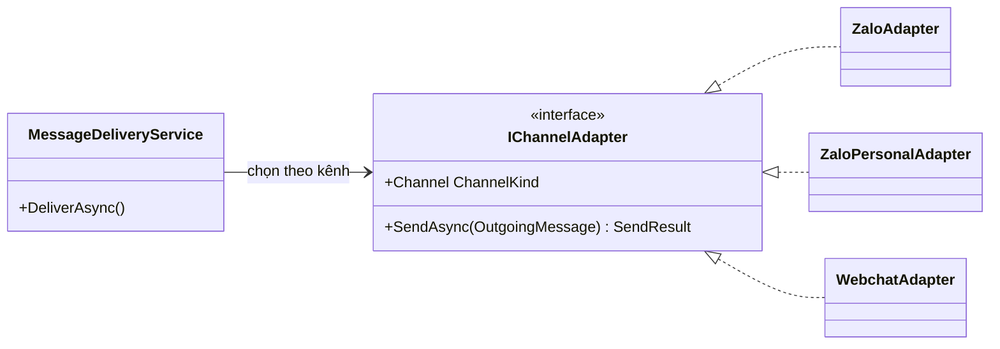

Worker chỉ biết `IChannelAdapter`. Thêm Messenger hay chat website = thêm một adapter, không sửa luồng xử lý tin nhắn.

### Mô hình dữ liệu (rút gọn)

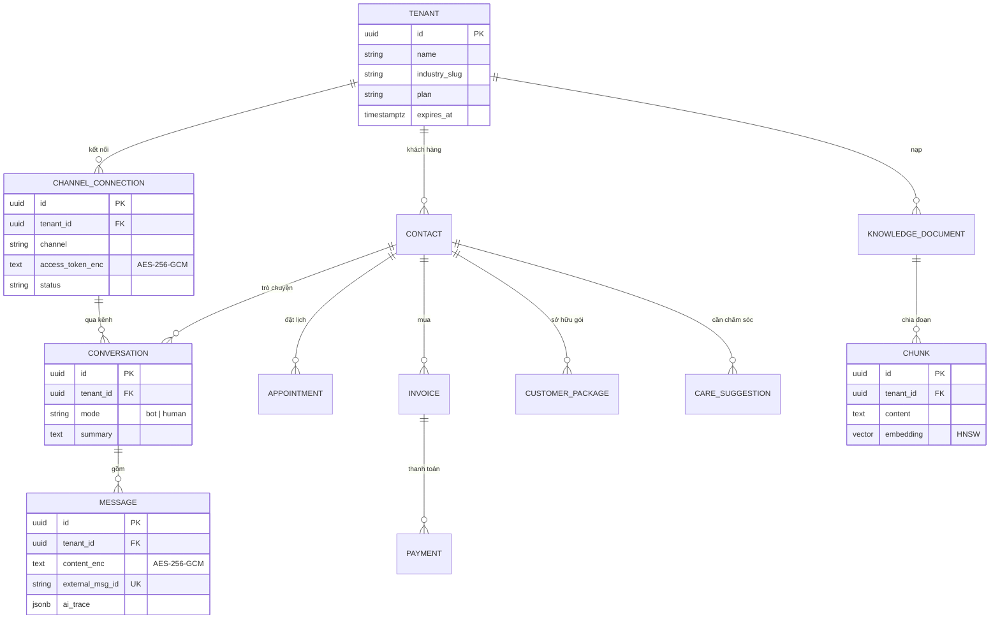

---

## 🛡 Bảo mật và tuân thủ

Thiết kế theo Nghị định 13/2023, Luật Bảo vệ dữ liệu cá nhân, quy định chống tin nhắn rác, Luật Bảo vệ quyền lợi người tiêu dùng
và chính sách của Zalo:

| Yêu cầu | Cách làm trong code |
| --- | --- |
| Khách biết đang chat với AI | Tin đầu tiên luôn có câu báo trợ lý AI + link chính sách bảo mật của doanh nghiệp, **không tắt được** |
| Không gửi dữ liệu cá nhân cho AI | Che SĐT, email, CCCD, tên, địa chỉ bằng placeholder trước khi gọi AI; bản gốc mã hóa trong DB |
| Bot không nói bậy | Danh sách câu cấm theo ngành kiểm tra trước khi gửi; ngành sức khỏe: không chẩn đoán, không kê thuốc, không hứa kết quả |
| Bảo vệ token và dữ liệu nhạy cảm | AES-256-GCM cho token kênh, nội dung tin, SĐT; secret chỉ ở biến môi trường |
| Doanh nghiệp giữ quyền kiểm soát | Kết nối OA bằng OAuth, **không bao giờ hỏi mật khẩu Zalo**; ngắt kết nối là xóa token |
| Minh bạch truy cập | Audit log khi xem, xuất dữ liệu khách |
| Quyền của khách cuối | Xóa / xuất dữ liệu một khách; xóa toàn bộ dữ liệu khi doanh nghiệp ngừng thuê |
| Chống làm phiền | Đồng ý nhận tin, nhắn "hủy" là dừng, khung giờ + tần suất cài cứng |
| Log an toàn | Serilog JSON có chính sách redact: không log token, API key, SĐT, nội dung tin |

**Độ tin cậy:** webhook chỉ xác thực → chống trùng → enqueue → trả 200; mọi lệnh gọi ra ngoài có timeout, retry và circuit breaker
(`Microsoft.Extensions.Http.Resilience`); job idempotent nên chạy lại không gửi trùng tin; khóa phân tán khi làm mới token
(refresh token chỉ dùng được một lần); lỗi được gom về Sentry.

---

## 🧰 Công nghệ

| Lớp | Công nghệ |
| --- | --- |
| Backend | C# · .NET 10 · ASP.NET Core Minimal API · FluentValidation · OpenAPI |
| Dữ liệu | PostgreSQL 16 + pgvector (HNSW) · EF Core + Npgsql · snake_case naming |
| Hàng đợi | Hangfire + Hangfire.PostgreSql |
| Cache / khóa | Redis 7 (StackExchange.Redis) |
| AI | Gemini (chat + embedding) · Groq dự phòng · gọi REST qua HttpClient |
| Đọc tài liệu | PdfPig · DocumentFormat.OpenXml · ClosedXML |
| Kênh | Zalo Official Account API · connector Zalo cá nhân (Node.js 24, TypeScript) · webchat |
| Quan sát | Serilog (JSON, redact) · Sentry · Hangfire dashboard (chỉ super admin) |
| Kiểm thử | xUnit · Shouldly · Testcontainers (Postgres, Redis) · eval câu trả lời AI |
| Trang quản trị | Next.js App Router · TypeScript strict · Tailwind · shadcn/ui · openapi-fetch |
| Hạ tầng | Docker Compose (dev) · Docker (staging / production tách riêng) |

---

## 📈 Chất lượng

| | |
| --- | --- |
| **7** project .NET, tách lớp rõ ràng | **~37.000** dòng C# (chưa tính migration) |
| **200+** endpoint REST có OpenAPI | **21** migration EF Core |
| **670+** test case (unit + tích hợp với Postgres/Redis thật) | Test cô lập tenant ở mọi module |

```
dotnet format --verify-no-changes && dotnet build && dotnet test
```

`TreatWarningsAsErrors`, nullable reference types, analyzers bật toàn solution; version NuGet quản lý tập trung ở
`Directory.Packages.props`.

---

## 🚀 Chạy local

**Cần:** .NET 10 SDK, Docker Desktop (đang chạy). Trang quản trị: Node.js + pnpm, repo `zalo-ai-portal` đặt cạnh repo này.

**Cách nhanh (Windows):** chạy `dev` ở thư mục gốc repo. Script bật Postgres + Redis, build rồi mở từng cửa sổ: API (cổng 4000),
Worker, trang quản trị `../zalo-ai-portal` (cổng 3000), connector Zalo cá nhân và tunnel (nếu đã cấu hình).
Tắt: `stop` (giữ Postgres/Redis) hoặc `stop all`.

Chạy từng phần:

```bash
docker compose up -d                          # Postgres (pgvector) :5432, Redis :6379
dotnet build
dotnet test
dotnet ef database update -p src/ZaloAi.Infrastructure -s src/ZaloAi.Api
dotnet run --project src/ZaloAi.Api -- seed   # 2 doanh nghiệp mẫu
dotnet run --project src/ZaloAi.Api           # http://localhost:4000/health
dotnet run --project src/ZaloAi.Worker
```

Dữ liệu demo đầy đủ số liệu: `scripts\seed-demo.cmd` (tắt API trước; tài khoản `demo@remi.local` / `Dev@123456`, **chỉ dùng ở
máy dev**), xóa bằng `scripts\clear-demo.cmd`. Backup DB dev: `scripts\backup-db.cmd`, khôi phục: `scripts\restore-db.cmd <file>`
(xem `docs/OPERATIONS.md`).

Cấu hình đọc qua Options pattern và được kiểm tra khi khởi động (thiếu biến bắt buộc thì dừng ngay). Danh sách biến: `.env.example`.
Secret đặt bằng `dotnet user-secrets` (dev) hoặc biến môi trường, không đặt trong `appsettings.json`.

<details>
<summary><b>Kết nối Zalo OA khi chạy local</b></summary>

Zalo phải gọi được vào máy dev qua **https công khai** (callback OAuth + webhook). Dùng Cloudflare Tunnel với tên miền dự án
(DNS của `haulp.io.vn` quản lý ở Cloudflare) để có địa chỉ cố định, khai báo trên Zalo một lần.

1. Cài `cloudflared` (Windows): `winget install --id Cloudflare.cloudflared`
2. Đăng nhập + tạo tunnel (một lần):
   ```
   cloudflared tunnel login
   cloudflared tunnel create zaloai-dev
   cloudflared tunnel route dns zaloai-dev dev-api.haulp.io.vn
   ```
3. `dev` tự bật tunnel (cửa sổ "ZaloAi Tunnel", `stop` tự tắt) khi đã cài `cloudflared` và đăng nhập. Chạy tay:
   ```
   cloudflared tunnel --config scripts\tunnel-dev.yml run zaloai-dev
   ```
   `scripts/tunnel-dev.yml` chỉ mở các đường Zalo gọi vào (`/webhooks/zalo`, `/connect/zalo/callback`, file `zalo_verifier…html`,
   `/health`); đăng nhập, API quản trị, Hangfire, OpenAPI trả 404 từ ngoài internet. **Không** dùng `--url` (mở toàn bộ API dev).
4. **Xác thực tên miền** (Zalo bắt buộc trước khi lưu Callback URL; mỗi tên miền con xác thực riêng, `haulp.io.vn` KHÔNG bao `dev-api.haulp.io.vn`):
   app → **Xác thực domain** → khung **Tiền tố URL** → `https://dev-api.haulp.io.vn` → lấy mã trong tên file `zalo_verifier<mã>.html`, rồi
   `dotnet user-secrets set "Zalo:SiteVerificationToken" "<mã>" --project src/ZaloAi.Api`, chạy lại API, mở thử
   `https://dev-api.haulp.io.vn/zalo_verifier<mã>.html` → bấm **Xác thực** trên Zalo. (Không dùng bản ghi TXT cho `dev-api` được vì đã có bản ghi tunnel.)
5. Trên developers.zalo.me → app → **Official Account → Thiết lập chung**: Callback URL = `https://dev-api.haulp.io.vn/connect/zalo/callback`.
   **Webhook**: URL = `https://dev-api.haulp.io.vn/webhooks/zalo`, tắt "Lọc cú pháp", bật Webhook Retry, bật các sự kiện
   `user_send_*` và `oa_send_*`. Lấy **OA Secret Key** trên trang này.
6. Lưu cấu hình (một lần, dùng chung cho Api và Worker):
   ```
   dotnet user-secrets set "Zalo:AppId" "<App ID>" --project src/ZaloAi.Api
   dotnet user-secrets set "Zalo:AppSecret" "<Khóa bí mật của ứng dụng>" --project src/ZaloAi.Api
   dotnet user-secrets set "Zalo:WebhookSecret" "<OA Secret Key>" --project src/ZaloAi.Api
   dotnet user-secrets set "Zalo:OAuthRedirectUrl" "https://dev-api.haulp.io.vn/connect/zalo/callback" --project src/ZaloAi.Api
   ```
7. Chạy `dev`, vào trang **Kết nối kênh** → "Kết nối Zalo OA" → đồng ý trên Zalo → nhắn thử từ Zalo cá nhân vào OA.

Ghi chú API Zalo đã kiểm chứng: `docs/zalo-api-notes.md`.

</details>

<details>
<summary><b>Kênh Zalo cá nhân khi chạy local</b></summary>

Doanh nghiệp kết nối nick Zalo cá nhân của mình bằng **quét QR**, không bao giờ nhập mật khẩu. Connector ở
`connectors/zalo-personal/` (README riêng, hợp đồng với API ở `CONTRACT.md`).

1. Khóa chung (một lần): đặt cùng một chuỗi ≥ 32 ký tự vào
   `dotnet user-secrets set "ZaloPersonal:SharedSecret" "..." --project src/ZaloAi.Api`
   và `REMI_SHARED_SECRET` trong `connectors/zalo-personal/.env` (copy từ `.env.example`).
2. `dev` tự bật connector (cửa sổ "ZaloAi Personal :4100", lần đầu tự `npm ci`) khi có file `.env`. API nghe thêm cổng nội bộ
   `127.0.0.1:4001` cho connector gọi vào; cổng này không đi qua tunnel.
3. Chưa có nick để thử: giữ `ZaloPersonal:Mode=Fake` (mặc định ở `appsettings.Development.json`) và `REMI_MODE=fake` → trang Kênh
   hiện bảng **giả lập** (quét QR giả, khách nhắn, chủ nick nhắn tay, mất kết nối...). Thử với nick thật: đổi cả hai sang
   `Real` / `real`, nên dùng nick phụ.

</details>

---

## 🗺 Lộ trình

| Giai đoạn | Nội dung | Trạng thái |
| --- | --- | --- |
| M1–M2 | Nền tảng, đăng nhập, multi-tenant · Kho kiến thức RAG | ✅ Xong |
| M3 | Lõi AI, chat thử, eval, bộ an toàn ngành | ✅ Xong |
| M4–M5 | Kết nối Zalo OA · Hộp thư realtime, tiếp quản | ✅ Xong |
| M6 | Khách tiềm năng, "Cần chăm sóc", dashboard, super admin | ✅ Xong |
| C1–C6 | CRM: chi nhánh, lịch hẹn, bán hàng & gói, kho, nhân viên, báo cáo | ✅ Xong |
| Z1–Z4 | Kênh Zalo cá nhân: kết nối QR, nhịp gửi an toàn, chăm sóc chủ động, tin nhắn mẫu | 🚧 Đang kiểm thử thật |
| C7 | AI dùng dữ liệu CRM: chăm sóc sau buổi, gói sắp hết, sinh nhật, kéo khách cũ | ⏳ Tiếp theo |
| C8 | PWA + push, đặt lịch online, hạng thành viên, ảnh trước/sau | ⏳ |
| Phát hành | Staging + production, load test, dùng thử với doanh nghiệp thật | ⏳ |

---

## 📚 Tài liệu

| Tài liệu | Nội dung |
| --- | --- |
| [`CLAUDE.md`](CLAUDE.md) | Nguyên tắc sản phẩm, kiến trúc, quy tắc code, kế hoạch từng module |
| [`docs/ROADMAP.md`](docs/ROADMAP.md) | Lộ trình đến phát hành |
| [`docs/CRM-FEATURES.md`](docs/CRM-FEATURES.md) · [`docs/CRM-PLAN.md`](docs/CRM-PLAN.md) | Tính năng CRM và các đợt C1–C8 |
| [`docs/FEATURE-SPECS.md`](docs/FEATURE-SPECS.md) | Chuyển tiếp nhân viên, "Cần chăm sóc", tình huống chăm sóc |
| [`docs/INDUSTRIES.md`](docs/INDUSTRIES.md) | Mẫu ngành, mức rủi ro, bộ an toàn y tế |
| [`docs/KNOWLEDGE-FORMAT.md`](docs/KNOWLEDGE-FORMAT.md) | Mẫu dữ liệu chuẩn cho kho kiến thức |
| [`docs/DECISIONS.md`](docs/DECISIONS.md) | Các quyết định kỹ thuật và lý do |
| [`docs/OPERATIONS.md`](docs/OPERATIONS.md) | Vận hành: Sentry, backup, CI |
| [`docs/ONBOARDING-FLOW.md`](docs/ONBOARDING-FLOW.md) | Dựng một doanh nghiệp từ đầu |
| [`docs/TEST-PLAN.md`](docs/TEST-PLAN.md) · [`docs/TEST-FLOW.md`](docs/TEST-FLOW.md) | Checklist và kịch bản test tay |

<div align="center">
<sub>Remi · remember + reminder · nhớ từng khách, nhắc đúng lúc.</sub>
</div>
